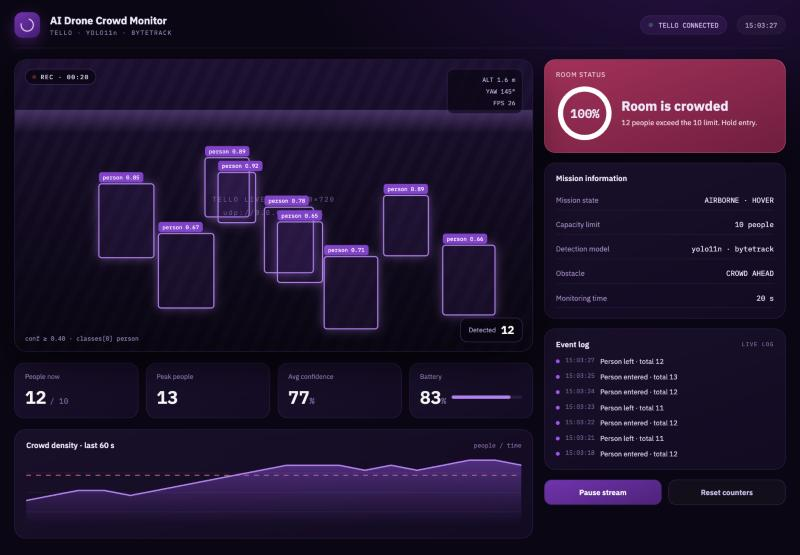
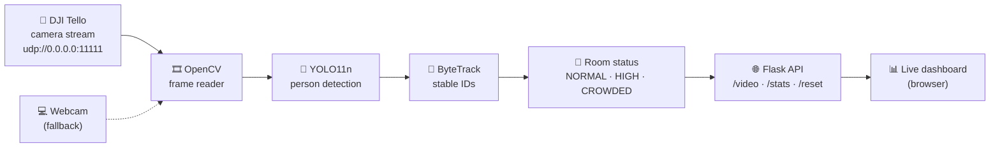

<div align="center">

# 🚁 AI Drone Crowd Monitor

**A DJI Tello drone counts people in a room in real time and warns you before it gets crowded.**

YOLO11 detects every person, ByteTrack follows each one across frames, and a live dashboard shows
how full the room is: **Normal → High → Crowded**.




<sub>The dashboard in demo mode (simulated people) — the live version shows the drone's real feed.</sub>

</div>

---

## ✨ What it does

| | |
|---|---|
| 🎥 **Live drone feed** | Streams the Tello camera (or a webcam) with a box and confidence score on every person. |
| 🧍 **People counting** | YOLO11n detects people (class 0) at ≥ 40% confidence, every frame. |
| 🔁 **Tracking, not just detection** | ByteTrack gives each person a stable ID, so the log knows when someone **enters** or **leaves**. |
| 🚦 **Room status** | Compares the count with the room's capacity: **NORMAL**, **HIGH** (≥ 70%) or **CROWDED** (at or over the limit). |
| 📊 **Live dashboard** | People now / capacity, peak, average confidence, battery, altitude, FPS, density chart and event log. |
| 🛟 **Safe flight** | Pre-flight battery check (≥ 40%), one-key landing and an emergency stop that always wins. |

## 🧠 How it works



1. **Capture** — `server.py` reads the Tello video (or a webcam if the drone isn't connected).
2. **Detect** — YOLO11n finds every person in the frame.
3. **Track** — ByteTrack keeps the same ID on the same person, so entries and exits are logged once.
4. **Decide** — the count is compared with the room capacity (`--max`):

   | Status | Rule (capacity = 10) | Dashboard |
   |---|---|---|
   | 🟣 **NORMAL** | fewer than 70% of capacity (0–6 people) | "Normal level" |
   | 🟠 **HIGH** | 70% of capacity or more (7–9 people) | "High density" |
   | 🔴 **CROWDED** | the capacity is reached (10 or more) | "Room is crowded" + crowd alert in the log |

5. **Serve** — annotated frames go out as an MJPEG stream (`/video`) and the numbers as JSON (`/stats`).
6. **Show** — the dashboard polls `/stats` every 500 ms and updates instantly.

## 🚀 Quick start

```bash
git clone https://github.com/lolo67fa/DroneCrowdMonitoringSystem.git
cd DroneCrowdMonitoringSystem
pip install -r requirements.txt
```

`yolo11n.pt` is included in the repo, next to `server.py`.

**Try it with your webcam (no drone needed):**

```bash
python server.py
```

**Fly with the Tello** (connect your computer to the Tello's Wi-Fi first):

```bash
python main.py
```

Or run only the detection server on the drone's camera, with a room capacity of 10:

```bash
python server.py --tello --max 10
```

Then open **`Drone Crowd Dashboard Live.dc.html`** in your browser. When the server is running you'll see:

```
Dashboard API running:  http://localhost:8000/stats
Live video:             http://localhost:8000/video
```

> 💡 No drone and no webcam? Open **`Drone Crowd Dashboard.dc.html`** — the demo dashboard with simulated data, made for presentations.

## 🎮 Flight controls (`main.py`)

| Key | Action |
|---|---|
| **F** | Pre-flight check → take off → open the dashboard |
| **L** | Land |
| **Space** | 🛑 Emergency stop (highest priority) |
| **Q** | Quit — lands first if the drone is flying |

`main.py` checks the connection, battery and camera before anything else, and refuses to take off below **40%** battery.
`server.py` never commands takeoff: it only connects, reads telemetry and runs detection.

## 🔌 API

| Method | Path | Returns |
|---|---|---|
| `GET` | `/video` | Live annotated stream (`multipart/x-mixed-replace` MJPEG) |
| `GET` | `/stats` | `{people, peak, occupancy, confidence, status, max_people, battery, altitude, fps, elapsed, source, connected, logs[]}` |
| `POST` | `/reset` | Resets peak, timer and event log |

If the server runs on another machine, set `serverUrl` in the dashboard's Tweaks panel (for example `http://192.168.1.20:8000`).

## 📁 Project structure

```
├── main.py                              # Flight control: preflight, takeoff, land, emergency + launches the dashboard
├── server.py                            # Detection server: YOLO11n + ByteTrack, Flask API (/video, /stats, /reset)
├── Drone Crowd Dashboard Live.dc.html   # Live dashboard (reads the server)
├── Drone Crowd Dashboard.dc.html        # Demo dashboard with simulated data
├── person_tracking.py                   # Webcam-only detection + tracking test
├── yolo_tello_test.py                   # YOLO on the Tello stream (test)
├── opencv_tello_test.py                 # Tello video connection test
├── dashboard.py                         # Earlier Streamlit dashboard prototype
├── yolo11n.pt                           # YOLO11 nano weights
└── requirements.txt
```

## 🛠️ Built with

**Python** · **Ultralytics YOLO11n** · **ByteTrack** · **OpenCV** · **djitellopy** · **Flask** + **Flask-CORS** · **HTML/CSS/JS dashboard**

## 🎓 About

Final project of the **Drones Operation Using AI** program at **Tuwaiq Academy**.

**Ghala Alshreef** — [GitHub](https://github.com/lolo67fa) · [Portfolio](https://lolo67fa.github.io/ghala-portfolio/)
